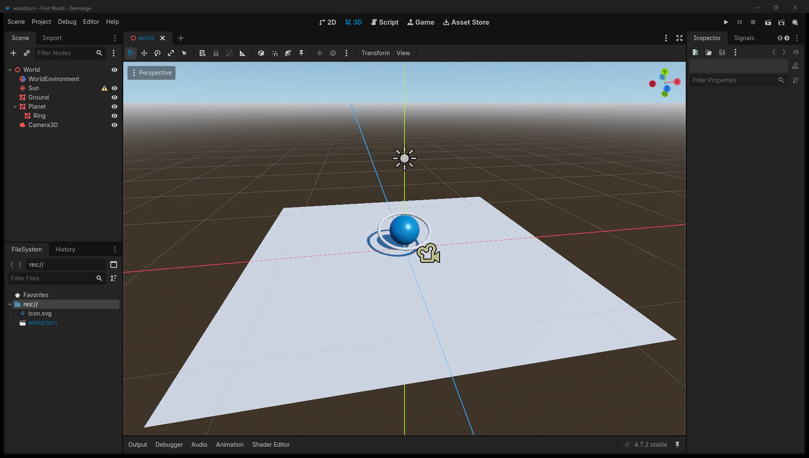

[](https://x.com/NorowaretaGemu)
[](LICENSE.txt)

<br>
<div align="center">
  <a href="https://ko-fi.com/cursedentertainment">
    
  </a>
</div>
<br>

<div align="center">
  
  
</div>
<br>

<div align="center">
  
</div>

# Demiurge

**Make worlds.** Demiurge is Atelier's game engine: 2D and 3D games for Windows and Linux, made in one editor on your
own PC. It is [Godot Engine](https://godotengine.org) 4.7, built as part of
[Atelier](https://github.com/CursedPrograms/Atelier), Cursed Entertainment's creative suite, in Atelier's look.

**Website:** https://cursedprograms.github.io/Demiurge/



## What it is

Everything Godot 4.7 does, under Demiurge's name and colours:

- **2D and 3D:** a dedicated 2D renderer with tilemaps, and 3D with real-time global illumination, volumetric fog and
  screen-space effects, on Vulkan, Direct3D 12 or OpenGL.
- **Scenes of nodes:** a player, a door or a whole level is a scene you can drop into other scenes.
- **Scripting:** GDScript, a visual shader editor, and C++ through GDExtension.
- **Physics and animation:** 2D and 3D bodies, joints and ragdolls; an animation player, blend trees and state machines.
- **Export:** Windows and Linux from the editor, with Demiurge's own export templates.

Godot projects, tutorials and add-ons work in Demiurge as they are (it opens `project.godot` files and saves them the
same way), so all of Godot's documentation applies: https://docs.godotengine.org/en/4.7/

### What Demiurge changes

- The name, the logo, the splash, the icons and the title bar (`version.py`, `misc/demiurge/make_logo.py`).
- The editor's default colours: the Changeling grey `#242424` and the Atelier blue `#007bb7`.
- The editor's own words say Demiurge where they meant the program; Godot's credits, About box and licences stay.
- Build, package and install scripts for Atelier (`build.bat`, `install.bat`, with `.ps1` and `.sh` twins).

## Install

Download `Demiurge-win64.zip` from the [releases](https://github.com/CursedPrograms/Demiurge/releases), unzip it and
run `install.bat` (Start menu and Desktop shortcuts), or just run `Demiurge.exe`. It's also in the Atelier launcher.

## Build

Needs Visual Studio 2022 (C++) and Python 3 with SCons (`pip install scons`).

```bat
build.bat              :: the editor: bin\, dist\Demiurge and dist\Demiurge-win64.zip
build.bat templates    :: also the export templates (what exported games run on)
install.bat            :: installs dist\Demiurge for this user
```

The first build downloads AccessKit and the Direct3D 12 SDK into `bin\build_deps` and takes about an hour on 12 threads.
On Linux, `./build.sh` builds the Linux editor (with Godot's usual packages installed, see
[README.godot.md](README.godot.md)) and `./install.sh` installs it.

## Credits

Demiurge is [Godot Engine](https://github.com/godotengine/godot) 4.7.2 (MIT), © 2014-present Godot Engine contributors,
© 2007-2014 Juan Linietsky, Ariel Manzur. Godot's own README is [README.godot.md](README.godot.md); its licence is
[LICENSE.txt](LICENSE.txt) and the licences of everything it includes are in [COPYRIGHT.txt](COPYRIGHT.txt). The name
on the logo is set in [Inter](https://rsms.me/inter/) (OFL), which Godot ships. See [NOTICE](NOTICE).

<br>
<div align="center">
<a href="https://cursedprograms.github.io/Demiurge/" target="_blank">
    
</a>
</div>

---
<br>
<div align="center">
<a href="https://github.com/Farica-Kimora">Farica☆Kimora</a> © Cursed Entertainment 2026
</div>
<br>
<div align="center">
<a href="https://cursed-entertainment.itch.io/" target="_blank">
    
</a>
</div>
